# BeEffic · Terapia visual: redesign concept

> Unsolicited concept redesign of the BeEffic visual therapy patient app, made by a patient who uses it daily. Not affiliated with or endorsed by BeEffic.

I'm a product designer, and I do my visual therapy exercises with this app every day. This repo is a working prototype of how I think it should work, built with Expo, React Native and TypeScript.

| Current app | Redesign |
|---|---|
| 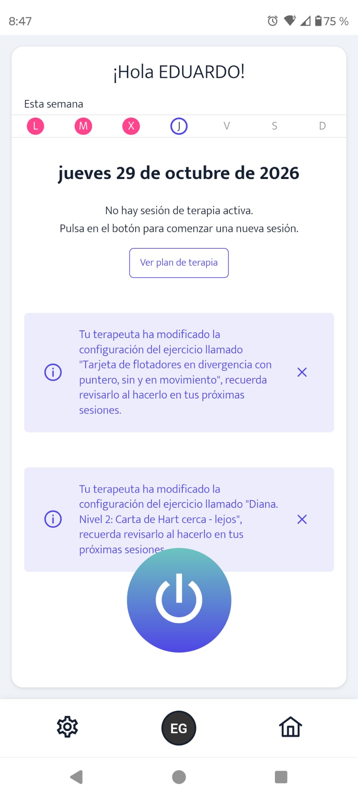 | 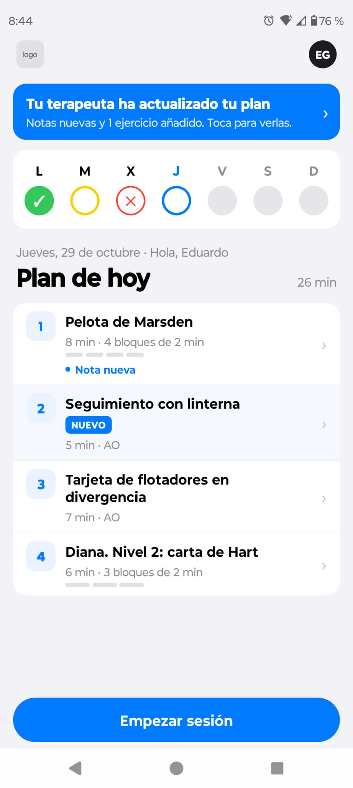 |
| 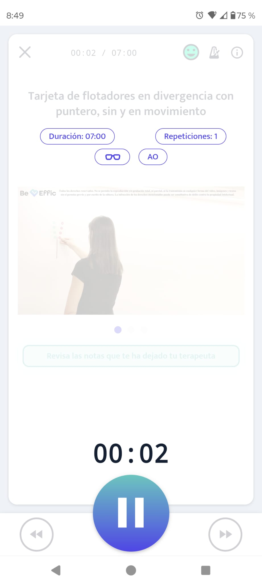 | 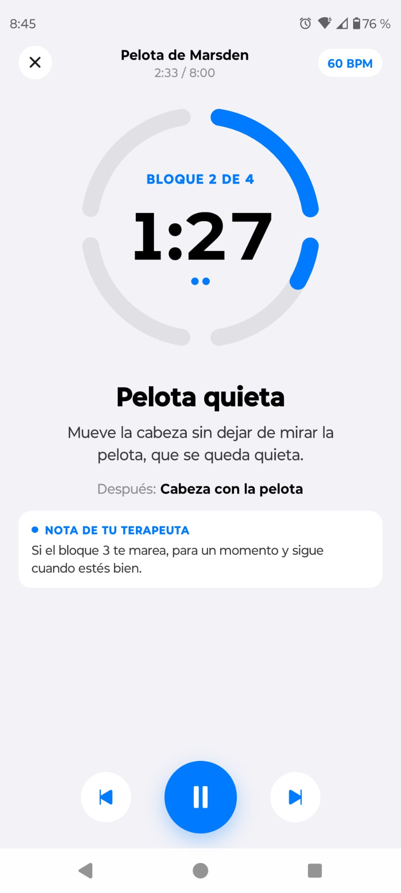 |

## The problem

Many of my exercises are measured by **time and repetitions**, and are split into parts: sitting, then standing; left eye, then right eye. The current app gives me nothing that tells me **when it's time to move to the next part**. I end up watching a clock instead of doing the exercise.

## What I changed

- **Exercises split into blocks.** Each exercise is a sequence of timed blocks, each with its own short instruction.
- **Sound cues for every block change.** The number of tones matches the block you're starting (two tones means block 2), so you know where you are without looking at the screen. A pre-warning comes before each change and a different cue plays at the end.
- **Visual block progress**: a segmented ring shows the current block and the time left.
- **A friendlier, more modern visual design** across the whole flow: today's plan, mood check-in, exercise guide and instructions, the exercise itself, then a short self-assessment and a report for the therapist.
- **A block editor for the therapist** (design only): the therapist splits each exercise into blocks, writes the instruction for each one, and leaves notes the patient sees in the app.

## The flow

| | | |
|---|---|---|
| <br>Today's plan | 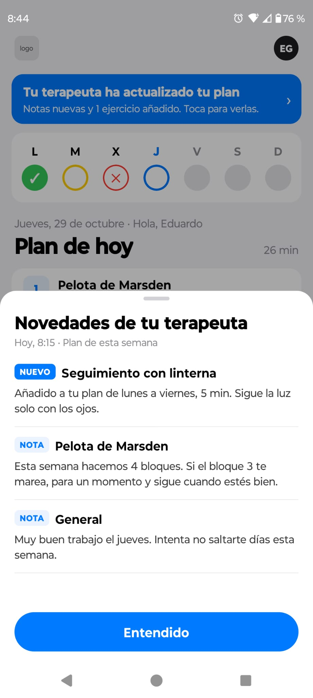<br>What the therapist changed | 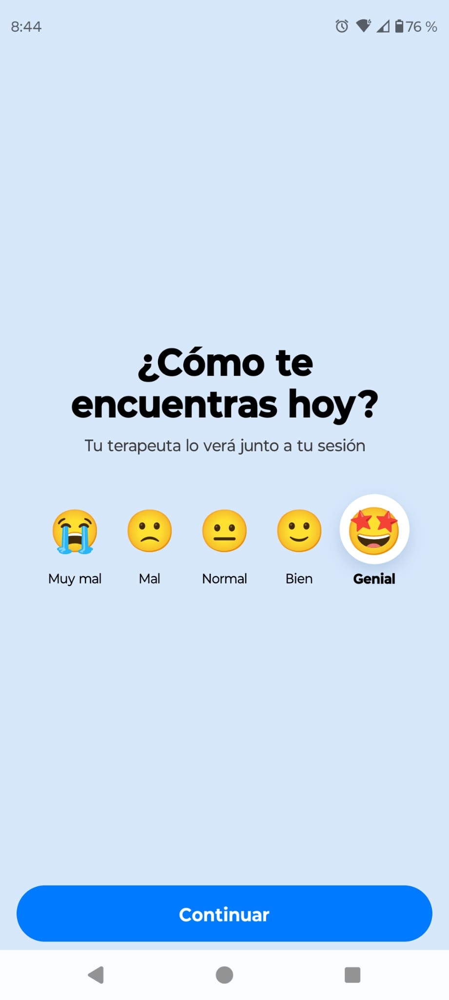<br>Mood check-in |
| 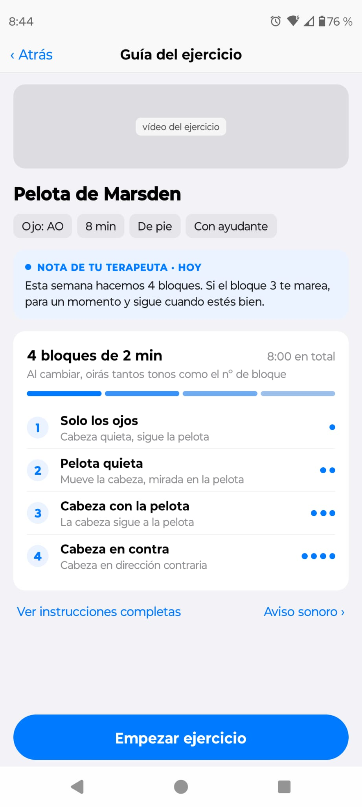<br>Exercise guide | 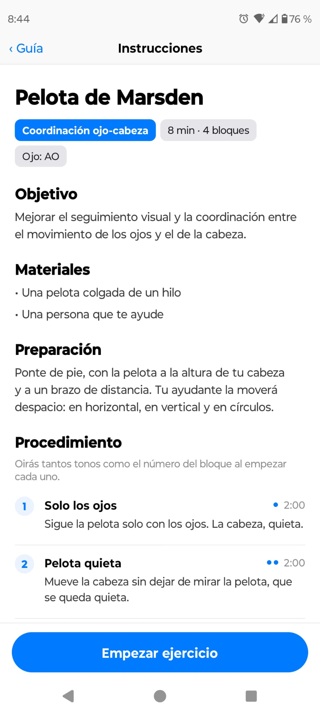<br>Instructions | <br>Exercise in blocks |
| 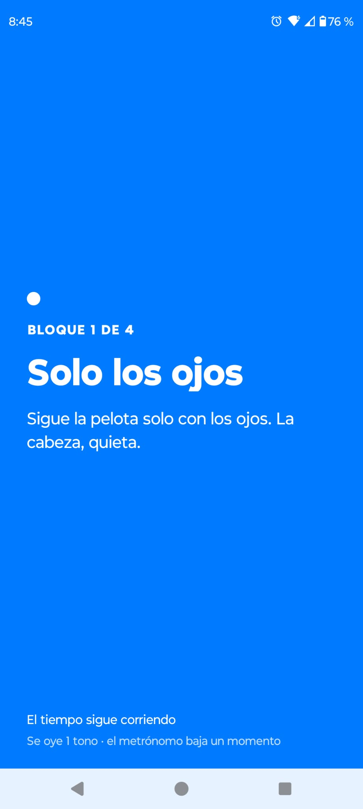<br>Block change | 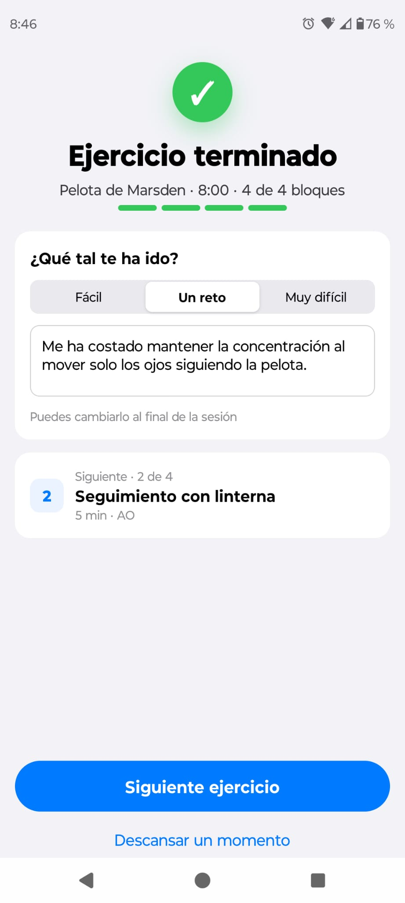<br>Exercise done | 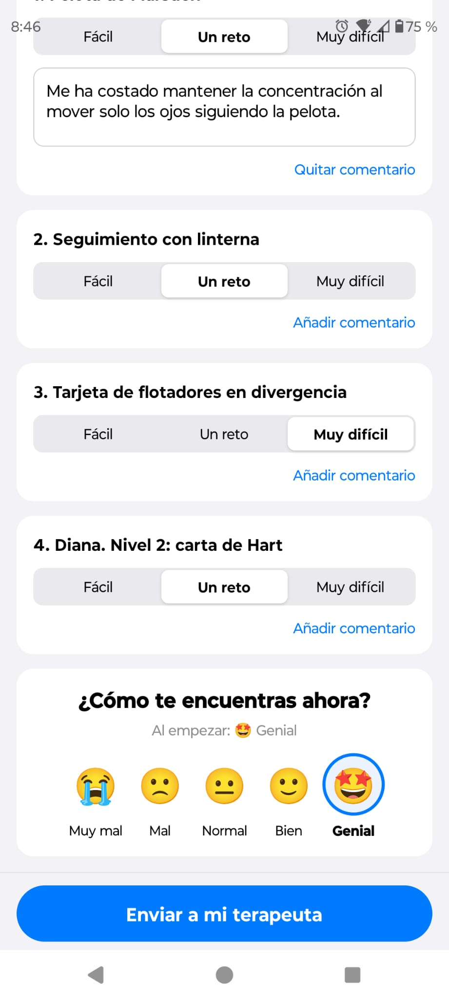<br>Self-assessment |
| 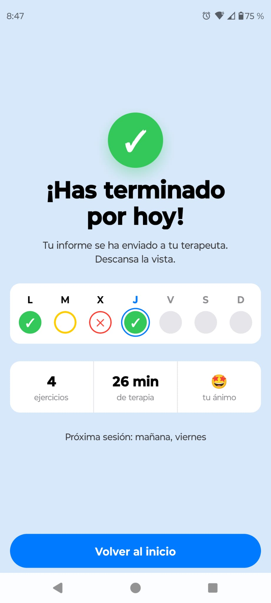<br>End of session | | |

## The therapist side

> Design concept only. This screen isn't part of the Expo prototype.

The blocks come from the therapist. In this editor they set the exercise's total time, repetitions and metronome, then split it into blocks, each with an instruction for the patient, a duration, the eye and the position. The footer checks that the blocks add up to the total and reminds them that the patient will hear N tones when block N starts.

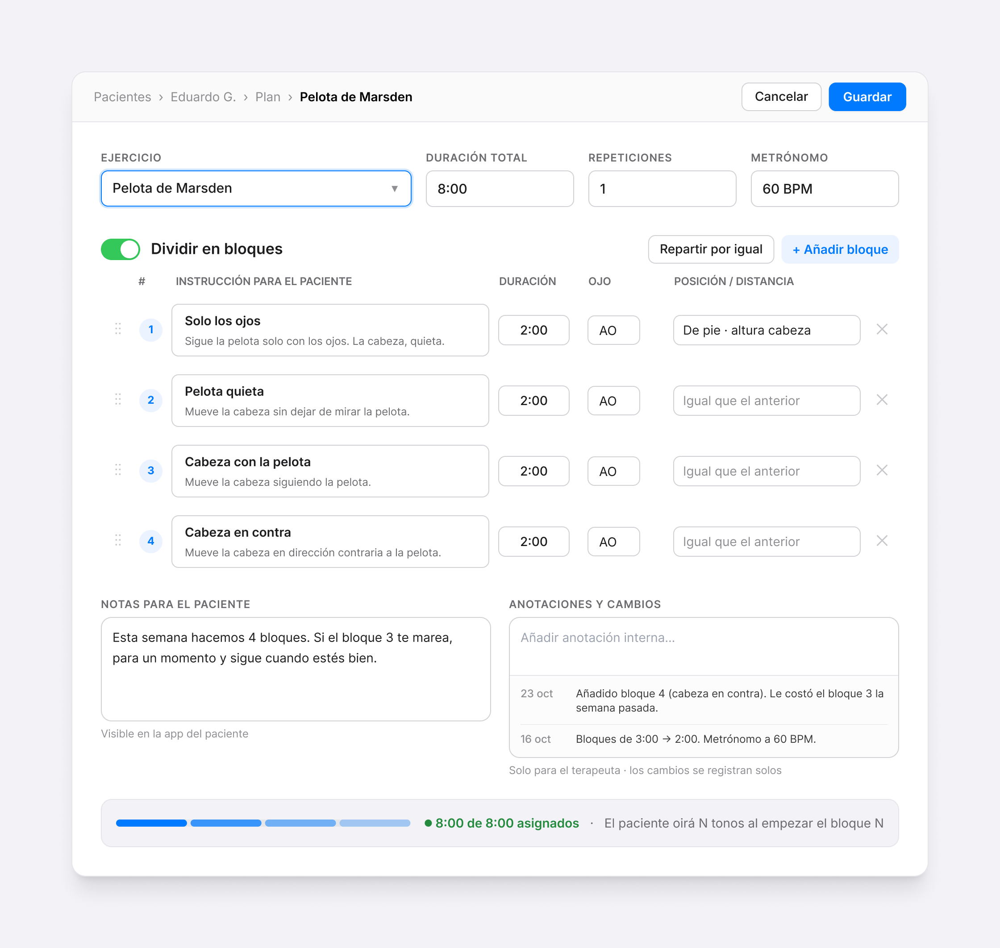

It's the other half of the patient screens above. These are the same four blocks the patient runs through (*Bloque 2 de 4 · Pelota quieta*), and the note about block 3 is the one shown during the exercise. Adding block 4 is logged under *Anotaciones y cambios*, and it's the change behind the "plan updated" banner on the patient's home screen.

## Run it

```bash
npm install
npx expo start          # press "w" for the browser, or scan the QR code with Expo Go
```

Everything except background audio works in the browser and in Expo Go. To build an installable Android APK:

```bash
npx eas-cli@latest login
npx eas-cli@latest build -p android --profile preview   # cloud build, outputs a .apk download link
```

## Demo tips

- Tap the **EG avatar** to open *Modo demostración*. It resets the day either to the "plan updated by the therapist" state (4 exercises and a banner) or to the normal plan (3 exercises).
- During an exercise, **⏭** jumps to the next block, so you can see the block-change overlay and hear the cues without waiting. On the last block, it finishes the exercise.
- Tap **60 BPM** to mute or unmute the metronome.
- When the report is sent, the mock payload is logged to the console.

## Structure

| Path | What |
|---|---|
| `src/app/` | Screens (Expo Router routes): today's plan, mood check-in, exercise guide, instructions, running exercise, settings, exercise done, self-assessment, end of session |
| `src/components/` | Shared UI: segment ring, mood picker, week card, note input |
| `src/data/plan.ts` | Mock exercises and plan, shaped so a backend could replace it |
| `src/store.tsx` | App state, persisted in AsyncStorage |
| `src/audio.ts` | Block-change cues, pre-warning, final cue, metronome with ducking |
| `scripts/gen-sounds.js` | Synthesises `assets/sounds/*.wav` (`npm run gen-sounds`) |

## Known gaps

- Only *Pelota de Marsden* has full copy. The other exercises' instructions and blocks are placeholders.
- The logo and exercise videos are placeholders.
- The therapist editor is a static design. The prototype's plan and blocks come from mock data in `src/data/plan.ts`.
- The timer runs in JavaScript, so cues don't play reliably while the phone is locked. A production version would need an Android foreground service.
